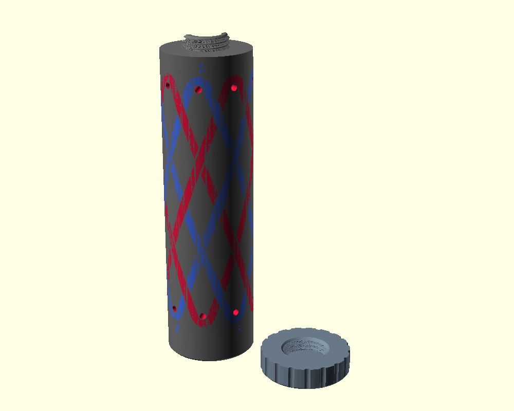

# Turk's Head Gaucho Generator

A Fusion add-in that builds 3D-printable jigs (mandrels) for tying Turk's head knots and their interweaves. The cord path is inlaid in colour on the surface, with pins at the bights and numbers showing the tying order, so you can follow the jig pass by pass.

## Knots

| Knot | Cords | Pattern |
|---|---|---|
| Turk's head | 1 | Over 1 / under 1 (other weaves in Advanced) |
| Gaucho interweave | 2–6 colours | N·L × N·B Turk's head, row-coded U^N O^N |
| Herringbone | 1–6 | Over 2 / under 2 along the cord. Several colours either *followed* (side by side in one band, like a doubled knot) or *interwoven* (spread round like the gaucho; odd colour counts with odd leads) |
| Headhunter's knot | 1 | Crossings in pairs of rows |

Leads and bights are kept tieable automatically: if they share a factor, the other number moves to the nearest value that works.

## Features

- **Colour lanes** – each cord's path is a flush inlay in its own sub-component (Cord A, Cord B, …), so each can be printed in its own filament. Lanes stop short where a cord goes under, so the weave reads straight off the jig.
- **Bight pins** – holes for 3 mm pins (or M3 screws) at every bight.
- **Pass numbers** – colour-matched numbers in tying order, plus A1 / B1 / C1 start labels for each colour.
- **Screw-on lid** – modelled ISO thread with print clearance and lead-in chamfers, scalloped grip, cord clamp notch, and pin storage inside the jig. The lid is laid out beside the jig, top down, ready to print.
- **Auto-sizing** – diameter and length grow to fit the knot and cord size.
- **Editable** – *Edit Turk's Head Gaucho Jig* rebuilds an existing jig with new settings.
- **Bambu Studio export** – *Export Turk's Head Jig for Bambu* writes one STL per part in shared coordinates. Drag the jig and cord files in together and choose "load as a single object with multiple parts".
- Optional handle, single-colour mode (lanes as recesses and grooves), and outline-only marking.

## Install

1. Download or clone this repository.
2. In Fusion: **Utilities → Add-Ins → Scripts and Add-Ins**, then the **+** on the Add-Ins tab, and select the `Turks Head Gaucho Generator` folder inside this repository (keep that folder name: Fusion needs it to match the add-in).
3. Select it and click **Run** (tick **Run on Startup** to keep it loaded).

The commands appear under **Solid → Create**.

## Use

1. **Create → Turk's Head Gaucho Jig**: pick the knot, colours, bights and leads. Everything else is under *Show advanced options*.
2. Print the jig with each Cord component in its own colour, and the lid separately.
3. Tie colour A first around the bight pins, following the numbers. For a gaucho, then lay each other colour from its start label along its lane. Where a lane stops short, that cord goes under.
4. Pull the pins, work the knot tight, tuck the ends.

## OpenSCAD version

`openscad/turks_head_gaucho_jig.scad` is a parametric port for people without Fusion. Same knots (Turk's head, 2-6 colour gaucho, herringbone in one or several colours, headhunter), auto-sizing, coloured over/under lanes, bight pin holes, colour-matched pass numbers, threaded lid with pin storage and clamp notch.

- Open the file, set options in Window > Customizer.
- `part = all` previews in colour. For multi-colour printing export `jig`, `lid` and each `cord_X` as separate STLs; they share coordinates, so load them as one multi-part object in the slicer.
- Rendering is slow with the CGAL engine. Use a recent OpenSCAD development snapshot with the Manifold backend (Preferences > Advanced > Backend).

## Credits

- Gaucho interweave rule checked against the Paracord Guild *Gaucho fan knot (7L6B)* tutorial and the row-coding model of Freakin' Sweet Knots' *Advanced Grid Maker*.

## Licence

[CC BY-NC 4.0](https://creativecommons.org/licenses/by-nc/4.0/): free to share and adapt with credit, not for commercial use. See [LICENSE](LICENSE).
